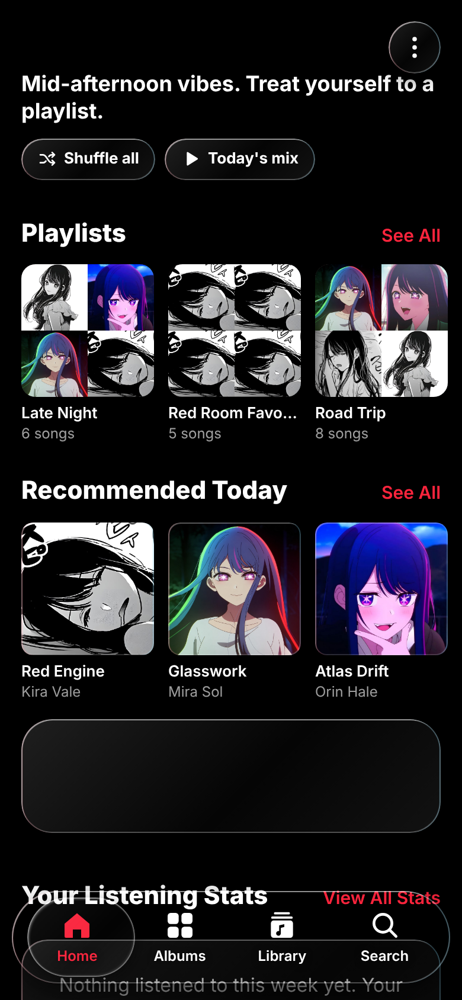
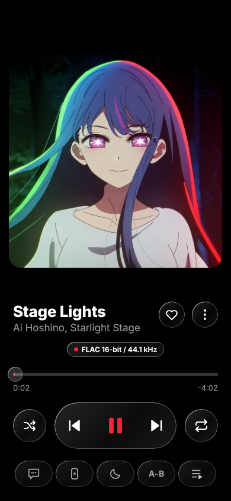
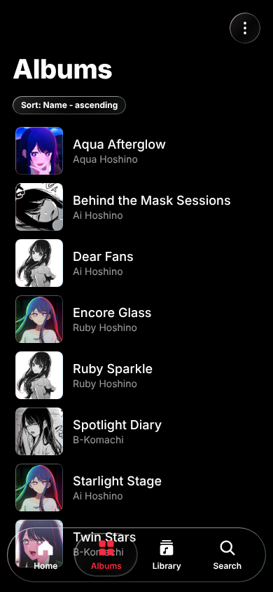
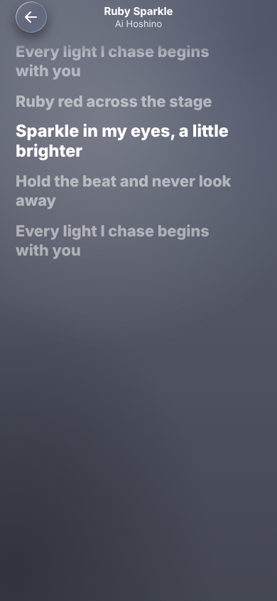
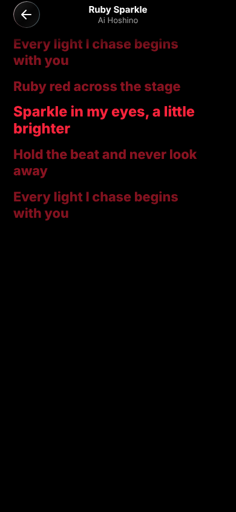
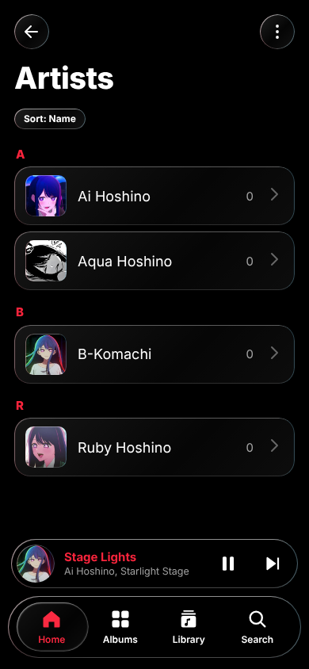

# Liquid Dark ★

**A free, offline music player for Android. I made it. Quietly. By myself, in the dark, where nobody was watching.** It isn't perfect, and I'll tell you where, because telling you the truth is something I've never been good at, so consider this practice. (Lying is kind of my job. Not in this file, though.)

*MIT license · No accounts, no ads, no streaming*

  
  
  
  

*Every picture here was taken from the app itself, at phone size, with a built-in demo library. The library is fake, and I'm telling you up front, which is more than I do for most things. No real music is shown. Nothing sneaky.*

---

## Hi, I'm Ai ☆

Ai Hoshino. Yes, the one with the stars in her eyes. Hello! ☆

(That's the smile. It's very good. I've had a lot of practice. You can stop looking at it now. Or don't. Most people don't.)

The stars are armor, by the way. Underneath they're dark. I'd rather you know that before you trust either of us.

I should introduce myself properly, since you're about to put my app on your phone. I didn't have the nicest start. My mother hit me. Once she put broken glass in my rice, because she was jealous. Then she got arrested, and I was sent to a children's home, and when she got out she never came to get me. I waited anyway. She didn't come. I don't hate her. I don't feel much about her at all, which is probably worse.

I couldn't remember loving anyone, or being loved by anyone. Nothing to copy from. So when people said "love", I could say the word, but nothing was behind it, and I decided I was empty. I got very good at hiding that. Under the sparkle I'm quiet, clumsy with money and with people, and I'd honestly rather be alone.

Then I heard something strange, and I held onto it: if you say "I love you" and keep saying it, maybe one day it turns real. I didn't believe it. I did it anyway, because the other choice was staying empty with no audience. So I became an idol. I smiled, I shone, I told thousands of people I loved them, and I hoped, quietly, that one of the lies would come true.

Here's what I decided on the way: lies are how I love people. You didn't want the real me, you wanted a dream, so I built one. I studied my smile until nobody could call it fake. I called that a gift. Some nights I called it stealing: taking all of your love and handing back something I made up. (I'm a greedy girl. I know.)

Lies and love, all mixed up. That's me. I even hid two kids from the whole world for a while. They're the only true thing I ever made. And I never told them I loved them, because if I said it and it was a lie, it would be the worst one I ever told, to the only people who mattered. (Once, when one of them wouldn't stop crying, I almost raised my hand. I've never been so scared of myself. I'm afraid of turning into her. Don't tell the tabloids.)

Anyway. That's why this README is going to be very honest with you. It's the one place I'm not going to do my usual trick. Not because I turned into a good person. Because this app is going to sit on your phone next to the songs you play at 3 a.m., when nobody's watching and nobody's performing. That deserves something real, and I don't have much of it, so I'm spending some here.

## What is this thing?

Liquid Dark started as a small project for my own FLAC collection. I wanted a player that looked calm and felt honest: black glass, one red accent, and the music sitting in the middle of the room like it owns the place. A stage after everyone has gone home, when the lights are off and the only thing left is the real thing. I'm sharing it now because other people who love their own files might want the same thing. Ehh, maybe you're one of them?

Fair warning: some parts are polished and some parts are still rough. I'd rather say so than pretend. Pretending is for the stage, and I'm tired of wearing the mask in my own project.

It plays the music you already own. Lossless **FLAC** is the star (16-bit, 24-bit and higher, any sample rate), and MP3 and AAC / M4A are welcome guests. Point it at your music folder once, and your library, lyrics, playlists, sleep timer and lock-screen controls are ready. No sign-in. No internet needed to listen. Easy, right?

## Why you'll like it

- **Your music stays with you.** No accounts, no streaming, no ads, no analytics. Your library lives on your phone, and I don't want it. Really. (I know what it's like to be watched all the time. I'd never do that to you.)
- **Built for lossless sound.** FLAC first, with gapless playback. MP3 and AAC / M4A still work.
- **Lyrics that move with the song.** Synced `.lrc` lyrics light up line by line, like a great live show, but without anyone shouting over the chorus.
- **A Home you can arrange.** A different greeting for every hour of the day, your name if you want it, and only the things that matter to you.
- **Free for everyone.** MIT license. Use it, copy it, change it, share it, and keep the credit. (The credit part is the only thing I ask. I'm a little vain, I admit it. I want to be remembered. Idols do.)

## Features

### Your library

- **Four tabs** in a floating glass bar: **Home**, **Albums**, **Library** and **Search**.
- **Home** is your start page. It has no big "Home" title: the greeting is the first thing under the top bar. It has a greeting for the time of day, quick buttons and rows such as Playlists, Recommended Today, Recently Played, Your Top Artists, Recently Added and Browse by Genre. Every row has **See All**. Settings > Home screen decides what shows, in what order and in which part of the day, and you can pin your own playlists, artists and albums to it.
- **Albums** shows a list with small covers. Each album page has a large cover, Play and Shuffle, and the song list, with disc headers for multi-disc albums.
- **Library** holds Playlists, Favorites, Recently Played, Most Played, Artists, Albums, Songs, Genres and Folders.
- **Artists** are split sensibly. Separators such as `feat.`, `ft.`, `;`, ` / ` and ` x ` are recognised, and `,` or `&` only split names that are known artists, so "Tyler, The Creator" stays whole. Various Artists albums are handled, and **Go to Artist** is available from any song menu. Press and hold an artist card on Home or in Library to change its photo.
- **Sort** songs, albums and artists by name, number of songs, duration, year, date updated, artist, album artist or composer, in either direction. Your choice is remembered for each list.
- **A-Z index** and letter headers make long lists easy to move through.
- **Search** covers artists, albums, songs and lyrics, with recent searches you can tap or clear.
- **Folder scan.** Pick your music folder once and rescan whenever you like. The app can also check for new or removed files when it opens or comes back to the front, at most every 10 minutes. Covers come from the FLAC picture or from a `cover.jpg`, `folder.jpg`, `front`, `albumart` or `album` image in the folder.
- **Fast scan with a live progress card.** The scan reads files in parallel, and a rescan skips songs and lyrics that haven't changed. You can hide the card with the X, and the scan keeps going.

| | |
|---|---|
|  **Home** |  **Albums** |

### Home, your way

Home is the first thing you see, so I made it yours and tried to keep it out of your way. Like a good backup dancer.

- **A greeting for every hour.** Each hour of the day has its own set of 210 messages, 5,040 in all, and a new one each time Home is built. Add your name in Settings > Profile, next to your picture, and it appears in the greeting. (I wrote a lot of them. I may have gotten carried away. 5,040 small hellos, and I'm very good at hellos.)
- **Calm by default.** Eight rows are on at first: Jump back in, Playlists, Recommended Today, Recently Played, Your Top Artists, Recently Added, Browse by Genre and Your Listening Stats. Everything else is one switch away.
- **Heavy Rotation, Favorites Mix and New Music Mix** are made from your own listening and shuffled fresh. Tap **See All** on any row to see the whole list, with Play and Shuffle.
- **Your own sections.** Create a section, name it, and fill it with any mix of albums, artists and songs, in the order you choose.
- **Pins.** Pin up to 12 playlists, artists or albums to Home.
- **A different Home for each part of the day.** Choose which sections show in the morning (5 to 11), afternoon (12 to 16), evening (17 to 20) and night (21 to 4).
- **Rename anything.** Give any section or quick button your own title.
- **Cards per row and card size** are yours to set: 6, 12 or 20 cards per row, and a size to match.

### Now Playing

- A large cover, the title, "Artist, Album", a quality badge such as **FLAC 24-bit / 96 kHz**, a scrub bar, shuffle, previous, play, next, repeat (off, all or one) and a heart for favorites.
- **Cover size.** Make the album cover bigger or smaller in Settings, from 40% to 100%, with a live preview. Reset returns it to automatic.
- **Cover shortcuts.** Tap the cover to view it full screen on pure black. Press and hold it to open the lyrics. You can switch press-and-hold off under Settings > Cover shortcuts.
- **Lyrics** work like Apple Music. They use synced `.lrc` files next to the FLAC (matched by a fuzzy file name), embedded lyrics tags and plain text. Enhanced `.lrc` files get word-by-word highlighting, and many encodings are read (UTF-8, UTF-16, GBK and Latin-1). The current line is highlighted and follows the song. Tap a line to jump to it, scroll freely, and tap **Now** to follow again.
- **Lyrics size.** A slider from 14 to 48 px, with a one-tap reset to the default.
- **Lyrics style.** Classic red lyrics on black, or white lyrics on the colour of the album cover, which changes with each song.
- **Lyrics animation.** Choose how the lines glide and fade, how big the playing line grows, how bright the others are, and how much the far lines blur. Presets are there if you want a starting point.
- **Sleep timer** for 15, 30, 45 or 60 minutes, until the end of the current song, or a custom time (type minutes like `90`, or hours and minutes like `1:30`, from 1 minute to 24 hours). It runs inside the playback service, so it works with the screen off. The volume fades out over the last 10 seconds, a countdown appears, and you can cancel it any time. (Goodnight. Sleep well. I know what lying awake feels like, so I made sure this one can end on its own. I'll keep the stars on for you.)
- **A-B loop** with draggable handles on the scrub bar.
- **Canvas.** Attach your own GIF, MP4 or image to a song or a whole album, and it loops on Now Playing.
- **Up Next.** Drag to reorder, remove, clear, or save the queue as a playlist. **Play Next** and **Add to Queue** are available from any song menu.
- **Autoplay.** When the queue runs low, similar songs (same artist or genre) are added from your library. **Smart shuffle** avoids playing the same artist or album back to back.
- **Song menu.** Favorite, play next, add to queue, add to playlist, go to album, go to artist, Canvas and Song Info.
- **Song Info.** A basic view (year, length, quality and more), plus **Extra details** with every tag, lyrics file details, audio details (bit depth, sample rate, channels, bitrate, block size and MD5), cover details and the file path.

| | |
|---|---|
|  **Now Playing** |  **Synced lyrics** |

### Playlists, favorites and history

- Create, rename and delete playlists. Add, remove and reorder songs, then play or shuffle. Playlist covers are a 2×2 mosaic, or your own first picture.
- **Pictures and GIFs in a playlist.** Add pictures or GIFs of any size to a playlist, view them full screen, pick the cover and remove them. They stay on your phone, untouched. Export / import playlists keeps songs and names, not the pictures.
- **Favorites**, **Recently Played** and **Most Played**. You can clear the history in Settings, and favorites and playlists stay.
- **Export and import playlists** to a file you choose, so they survive an uninstall. Clashing names are renamed, and missing songs are skipped with a summary.
- Your queue, position and last song come back when you reopen the app.

### Listening stats

- **Listening Stats** shows your listening time, top song, artist and album, your streak, and a last-7-days chart. The **Overall** tab holds all-time solar / lunar shares, year-by-year and month-by-month day and night listening.
- **Home screen widgets** read the listening database directly, so the stats stay right with the app closed: **Today** (small), **This week** and **This month** (wide), **Everything** (large) and **Listening: Daily** (today against yesterday, with a 24-hour chart). A tap on any of them opens Listening Stats.
- **More widgets.** **Now Playing (large)** shows the cover, song, artist, album and previous / play-pause / next. **Genres** shows your six biggest genres as chips; a chip opens that genre. Add them from Settings > Widgets, or from your home screen's widget list.
- **Clear data** sits at the bottom of the screen and asks "Are you sure?" before it runs.

### Pictures you can send live

Seven places in the app can show a picture or GIF that you publish in the project. None of them needs a new build, except the app logo, which also offers an update. It's like talking to everybody at once, from far away, where nobody can touch me. I like that more than I should.

- **Notification popup** from `notification-popup-gif-pic/`, shown once per upload.
- **Update popup** from `update-popup-gif-pic/`, on the Update available and Update ready screens.
- **Opening screen** from `splash-pic/`, shown on a black screen, up to 80% of the screen width and height, fitted to the uploaded picture's shape (never cropped or stretched), for at least 2.8 seconds when the app opens (pictures only, no GIF). No blink: the saved picture is read and decoded before the app script loads, then faded in over the black cover; the library loads underneath and Home shows its own loading animation if it takes longer.
- **Credits** from `credit-gif-pic/`, under Settings > About > Credits.
- **App logo** from `app-logo-pic/`, in Settings > About.
- **Allow background activity** from `background-allow-gif-pic/`, a full-screen card that opens Android's battery settings.
- **Home picture box** from `stats-banner-gif-pic/`, a glass box above Listening Stats on Home.

### Your own pictures and GIFs

A picture or a GIF works everywhere you can choose one. (GIFs are my favourite. They smile forever and never get tired. I'm a little jealous.)

- **Almost anything can have its own picture or GIF, and it REPLACES the original completely** (the original cover is not drawn under it, so a transparent GIF shows a plain dark square behind it, not the old cover). "Back to the original" in the same menu brings the original back. Albums, songs, artists, genres and playlists, each from its own menu. A song with its own picture shows it in song lists, search, the queue, Home cards, the mini player, Now Playing and the lock screen. A song without one shows its album's picture. Tapping the cover on Now Playing opens the original cover full screen by default; turn off Settings > Tap cover shows original to see your own picture or GIF there instead. On an album page, tapping the big cover always shows your own picture or GIF.
- **Your profile.** A picture, a GIF or a short video, next to your name in Settings.
- **Your background.** A picture or GIF behind the whole app, with Fill / Fit and a Darken slider (starts at 0%, so your picture is shown exactly as it is).
- **Any size, kept as it is.** Pictures and GIFs aren't shrunk, cropped or re-encoded, so a GIF keeps moving and a photo stays as sharp as the file you chose. That includes profile pictures and artist photos: the round or square shape is cut when the picture is drawn, not in the saved file.
- **Ready the moment you open the app.** They're saved twice on your phone, so they come back straight away after you close the app, swipe it away and open it again. On the lock screen, Android shows a GIF as a still image.

### Android and your headphones

- **Background playback** with a media notification that shows the cover, the title and "Artist, Album", including while paused and on the lock screen. It has previous, play and next controls, and tapping it opens Now Playing. A notch or island app can read the same notification.
- **Earphone and headset buttons.** Wired headsets: one press plays or pauses, two presses go to the next song and three to the previous one. Bluetooth earbuds that send media keys work the same way. If the app was closed, a play button starts your last queue again.
- Playback pauses for phone calls and when headphones are unplugged.
- **Bluetooth:** a chip under the title and a banner when a device connects, plus a device list in Settings.
- **Equalizer** opens your phone's own sound settings. Using it means the output is no longer bit-perfect. (A small lie of the audio kind. I won't hide it from you.)
- A notification permission prompt on first start (Android 13 and later), and a **Notification test** button.
- **Updates inside the app.** The app checks for a newer version about once a second while it's open. When one is published, it downloads in the background by itself, and then shows **Update ready**. Tap Install, confirm on the next screen (the update is required: there's no Later), and it installs over the old app. You never download an APK by hand, and your library and settings stay.
- **A message from the author.** When a new picture or GIF is published with the project, it appears once on a black background the next time you open the app. Any shape fits, it's never cropped or stretched, and the liquid glass buttons match the rest of the app. That's me, saying hi from behind the glass.

### Look and feel

- **Black liquid glass** throughout, with red as the only accent. There's no background blur, so long lists stay smooth. Large titles, round header buttons and a mini player above the tab bar.
- **Lyrics colour: any colour.** Now Playing > ... > Lyrics colour has no preset colour squares and no Android colour dialog. A colour wheel is built in: drag the small circle round the wheel to pick the colour, use the slider under it for brightness, or type a Hex code such as FFAA95. The colour you pick is used exactly as chosen (dark stays dark). Auto uses the album cover's own colour with no boost: the plain average of the cover's main colour area (grey, near-black and near-white pixels are ignored), or the song's own picture if you set one; "Back to Auto" returns to it.
- **Glass bar size.** One slider (40 % to 220 %) sets the size of the glass tab bar. It is in Settings > Display options and also in Settings > Liquid glass & wobble (the Animation screen), pinned under the test bar, and both are the same setting, so the size stays the same in the real bar, the test bar and every screen.
- **Liquid tab bar.** Press and hold, then drag between tabs. The pill stretches like liquid, and the icons it passes over turn red. The same pill is used on the player controls and on button pairs such as Play and Shuffle. Toggles have a liquid knob, and buttons squash when pressed. (Squishy! I poked it for a whole afternoon.)
- **Lens refraction.** The pill bends the picture behind its rim like thick glass. You can turn it off for plain glass.
- **Animation studio.** A test bar and sliders for wobble, stretch, pill size, magnification, bounciness and spring speed, with presets (Default, Watery, Max liquid and Calm).
- **Your own background.** Any picture or GIF, of any size, behind every screen (Settings > Home > Background picture or GIF), with Fill / Fit and a Darken slider.
- **Settings** include Home screen, Background picture or GIF, Lyrics animation, Now Playing cover size, your name for the Home greeting, Reduce Motion, album details, bigger album covers, lens refraction, lyrics text size, Background style, Cover shortcuts, Tap cover shows original, Increase Contrast, Autoplay, Equalizer, Bluetooth, the music folder, automatic checks for new music, clearing play history, playlist export and import, and more.
- **Accessibility.** TalkBack labels, large touch targets, focus that moves into and back out of sheets and dialogs, Escape or Back closes the top layer, and the phone's own Reduce Motion setting is respected.
- **App logo / launcher icon.** Drop a picture into `app-logo-pic/` on GitHub: the build bakes it into the APK as the home-screen icon (square, round and Android 8+ adaptive) and phones are offered the update. The picture fills the whole icon, the same size as the other icons on the launcher (BUG-162, fixed): it is not shrunk into a small safe zone and has no blurred frame on Android 8+. With no picture there, Android shows its own generic icon. The same picture also shows live in Settings > About. The opening splash shows the red liquid-glass note on black glass.

The full feature checklist is in [docs/FEATURES.md](docs/FEATURES.md).

## More screenshots

| | | |
|---|---|---|
|  **Albums** |  **Artists** |  **Immersive album cover** (Now Playing) |

These are the screenshots shipped with the project. They were taken from the app itself with the built-in demo library. The screen recordings below show more of the app.

## Screen recordings

Short clips of the app in use (demo library, Oshi no Ko-themed names and lyrics). Files are in [docs/screen-recordings](docs/screen-recordings).

- [01 Full app tour](docs/screen-recordings/01-app-tour.mp4)
- [02 Synced lyrics](docs/screen-recordings/02-lyrics.mp4)
- [03 Immersive album cover](docs/screen-recordings/03-immersive-cover.mp4)
- [04 Library: songs, genres, playlists](docs/screen-recordings/04-library.mp4)
- [05 Settings](docs/screen-recordings/05-settings.mp4)

## Get the app

1. On your phone, open the **Releases** page of this repository and choose **Latest build**.
2. Download **`liquid-dark.apk`** and open it. Android asks you to allow installs from your browser the first time. A `liquid-dark.apk.sha256` checksum file is published next to it if you want to verify the download.
3. Open Liquid Dark, allow notifications (so the lock-screen controls work) and pick your music folder.

**Updates** arrive inside the app. A newer version downloads by itself while the app is open, and then shows **Update ready**. Tap Install and confirm the install on the next screen.

**Privacy.** The app only makes a few small read-only requests to this project's GitHub page. They check whether a newer version exists and whether there's a new popup picture. Nothing about you or your music is sent. Of everything I could lie about, that's the one I won't.

## A small honest note

Some parts of Liquid Dark are polished and some are still a little rough. I could only test it on the phones I had, and I can't know how it behaves on yours. So if something wobbles, it's not you. Tell me. I'd rather hear an ugly truth than a pretty lie. (Yes, me. Growth. It's scary. You looking closely and finding the cracks is the part I'm most afraid of.)

## Contributing

Liquid Dark is a personal project that I look after in my own time and share with everyone. It's mine. I made it quietly, for me first, and sharing it is the part that scares me. Bug reports, feature ideas and pull requests are welcome, and I read every one, but I can't promise when I'll answer, or that every idea gets in. When you report a problem, please include your Android version, your phone model and the text from **Settings > Copy log**. Please keep the copyright notice in any copy you make.

## License

Released under the [MIT License](LICENSE). Copyright (c) 2026 Ai Hoshino. You may use, copy, change and share the software, including commercially. Keep the copyright notice with every copy.

## Credits

**Liquid Dark was created by Ai Hoshino.** All credit for the app goes to Ai Hoshino, and the credits are also shown in the app under Settings > Credits. It's the one thing I'll sign my real name to.

Thank you to everyone who tests the app, reports bugs and shares ideas. Your reports are how the rough parts get smoother. Liquid Dark is built on open-source libraries, including Capacitor, AndroidX Media3 and Vite, and each keeps its own license and credits its own authors.

Thank you for listening, even on the days I got it wrong.

I love you all. ☆

*(That one's true. I've been practicing.)*
